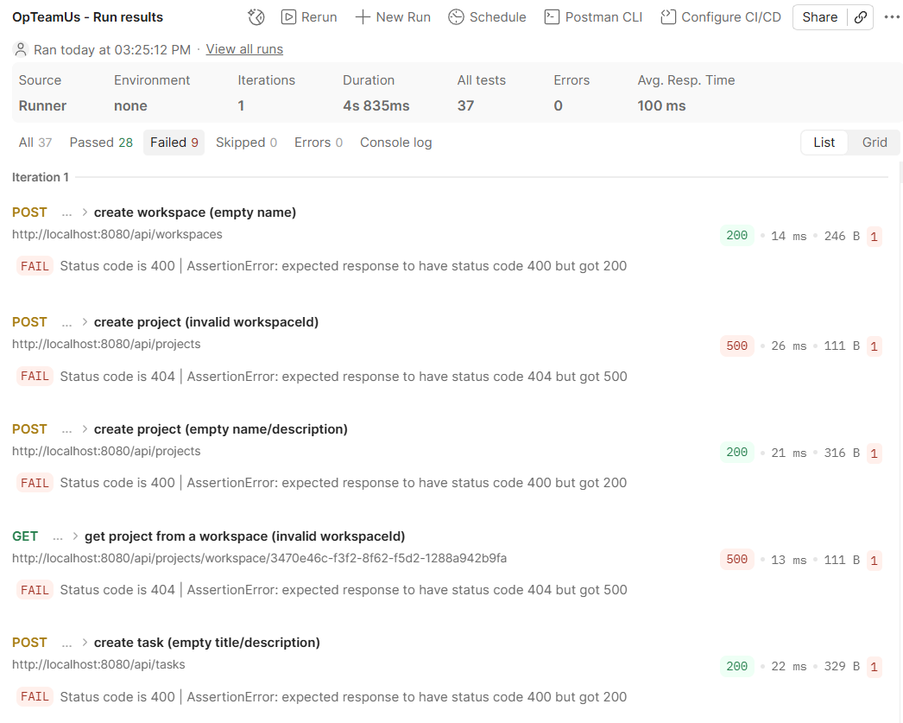
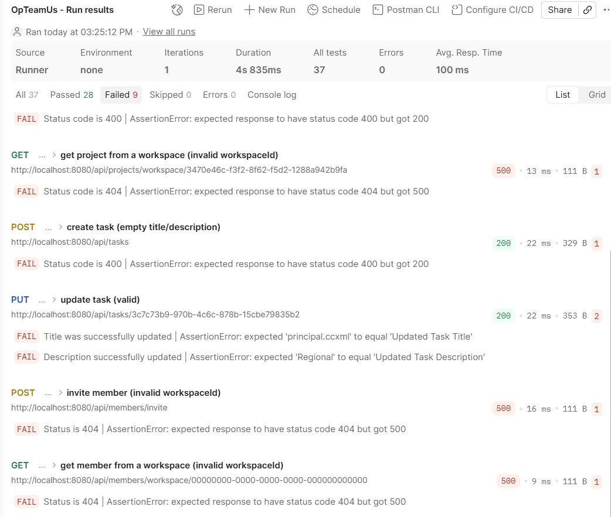
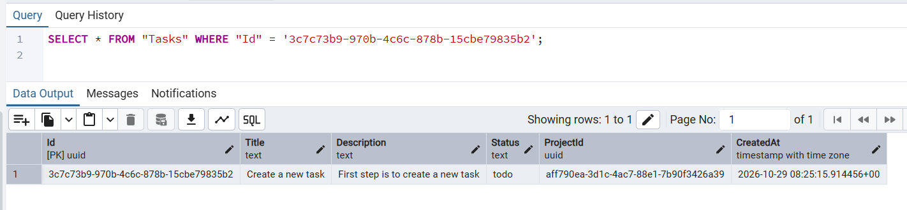
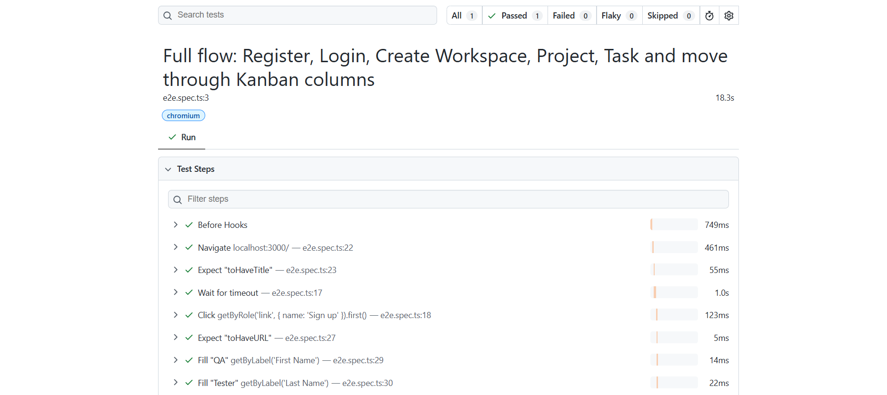

# OpTeamUs Defect Log & Bug Reports

This directory contains formal, production-grade defect reports discovered during the multi-layer QA testing cycle of the OpTeamUs platform.

---

## Defect Summary Matrix

| Defect ID | Severity | Priority | Title | Affected Component | Status |
| :--- | :--- | :--- | :--- | :--- | :--- |
| [**BUG-001**](BUG-001-missing-resource-500-error.md) | **High** | P1 | API returns 500 Internal Server Error instead of 404 for missing resources | `ProjectController`, `MembershipController` | Open |
| [**BUG-002**](BUG-002-empty-name-validation-bypass.md) | **High** | P2 | Backend lacks server-side validation for empty strings (UI-only validation) | `WorkspaceController`, `ProjectController`, `TaskController` | Open |
| [**BUG-003**](BUG-003-put-task-ignores-title-description.md) | **Critical** | P1 | PUT /api/tasks/{taskId} silently ignores Title and Description updates | `TaskController` | Open |
| [**BUG-004**](BUG-004-missing-workspace-member-fk-validation.md) | **Medium** | P2 | Missing Foreign Key / Role Validation when Adding Workspace Members | `MembershipController` | Open |
| [**BUG-005**](BUG-005-database-connection-missing-password-500.md) | **Critical** | P1 | Database connection missing password causes 500 crash on auth endpoints | `Program.cs`, Configuration, `AuthController` | Open |
| [**BUG-006**](BUG-006-undocumented-api-contract-responses-400-401.md) | **Medium** | P2 | Undocumented status codes (400, 401) violate OpenAPI contract specification | Controllers, Swashbuckle Swagger Spec | Open |

---

## Defect Severity Breakdown

```
  Critical (2)  [ 33.3% ] ██████████
  High     (2)  [ 33.3% ] ██████████
  Medium   (2)  [ 33.3% ] ██████████
  Low      (0)  [  0.0% ] 
```

- **Total Defects Identified:** 6
- **Resolved / Closed:** 0
- **Open (Documented with Remediation):** 6

---

## Defect Artifacts & Evidence

- **Postman API Test Failures:**
  - 
  - 
- **Direct Database SQL Verification:**
  - 
- **Playwright End-to-End Test Execution:**
  - 
- **Contract & Fuzz Testing (Schemathesis):**
  - Contract verification runs uncovered 500 Npgsql SASL authentication crashes (`BUG-005`) and 17 undocumented status code violations (`BUG-006`).
