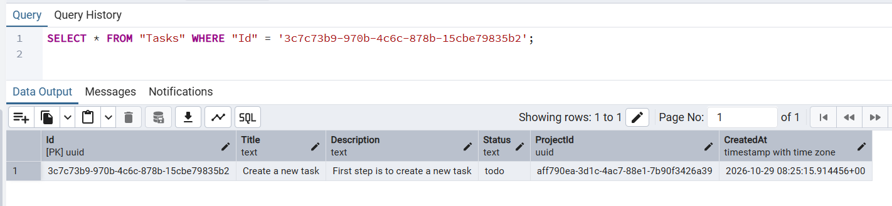

# OpTeamUs API Test Plan

## 1. Executive Summary
This document outlines the API testing strategy for the OpTeamUs backend. The goal was to transition the system from a manually callable state into a verified, automated test asset. The testing focused on functional correctness, negative paths, boundary values, and database integrity using Postman and SQL.

## 2. Scope
**In Scope:**
- **API Functional Testing:** Authentication, Workspaces, Projects, Tasks, and Members.
- **End-to-End (E2E) Integration:** Registering a user, logging in, creating a workspace, adding a project, creating/updating/deleting tasks, and inviting members.
- **Negative & Boundary Testing:** Missing tokens, invalid IDs, empty strings, and invalid roles.
- **Database Verification:** Running direct SQL queries to verify that API actions successfully persist to PostgreSQL.

**Out of Scope:**
- UI/Frontend testing (React/Vite).
- Performance/Load testing.
- Security penetration testing (beyond basic Auth checks).

## 3. Environment & Tools
- **Backend:** ASP.NET Core 8 Web API (Docker)
- **Database:** PostgreSQL (Docker)
- **Testing Tool:** Postman (Collection Runner)
- **Database Tool:** pgAdmin / DBeaver
- **Base URL:** `http://localhost:8080`

## 4. Test Approach
- **Equivalence Partitioning & Boundary Values:** Tested valid inputs against invalid ones (e.g., creating a task with a valid title vs. an empty string).
- **Chaining & State Management:** Used Postman collection variables (e.g., `{{workspaceId}}`, `{{token}}`) to pass IDs down the chain, ensuring the entire E2E flow works smoothly.
- **Automated Assertions:** Every request includes `pm.test` assertions to automatically verify HTTP status codes (200, 400, 401, 404) and validate response payload structure.

## 5. SQL Verification Records
**Objective:** To ensure the API correctly persists data to the database, not just in memory.

**Test Case:** Verify Task is successfully created in the Database.
**Postman Action:** Executed `POST /api/tasks`. Received Task ID `3c7c73b9-97...`
**SQL Query Executed:**
```sql
SELECT * FROM "Tasks" WHERE "Id" = '3c7c73b9-970b-4c6c-878b-15cbe79835b2';

